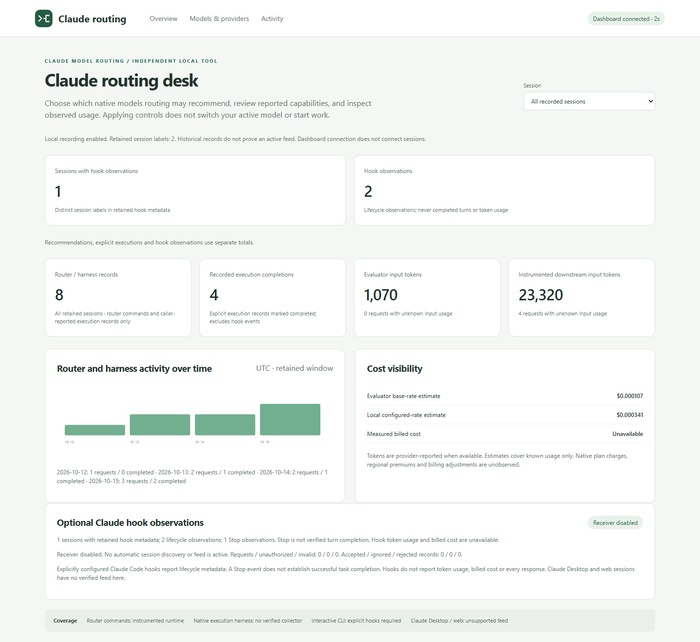

# Claude Model Router

Claude Code routing skills plus a standalone localhost dashboard, optional
OpenAI Decisions selection, generic local LLM execution, and a redacted session
ledger. The main Claude session owns requirements, validation and final judgment.
Native recommendations remain advisory: this package does not automatically
switch or dispatch work into an existing Claude Code session.

Adapted from the [Codex router](https://github.com/peterjohannmedina/codex-model-routing)
with separate [Claude contracts](docs/claude-contracts.md) and
[architecture boundaries](docs/adaptation.md).

| Feature | Implemented behavior | Boundary |
| --- | --- | --- |
| Dashboard | Models/providers, budgets, sessions, activity and decision details | Separate from Claude's model picker |
| Model eligibility | User-confirmed /model entries, source/timestamp, eligibility checkboxes | API models and aliases never prove subscription access |
| Overrides | Direct-user model/effort override file precedes selection | Unsupported combinations fail explicitly |
| Decisions | Optional candidate selection with rules fallback | Default off; explicit API consent and existing key required |
| Local LLM | Exact model on a generic Chat Completions endpoint | No Muse dependency; execution separately authorized |
| Efficiency | Output bounds, evaluator token/cost ceilings, local preference | Estimates labeled; no guaranteed subscription savings |
| Decision records | Alternatives/probabilities, confidence, evaluator/policy provenance, latency | Confidence is not answer quality |
| Telemetry | Opt-in hook metadata attributed by session | Observed models and completed turns distinct; usage may be unknown |
| Lifecycle | Versioned install, detached start/reopen, optional startup, rollback | Preserves credentials, model settings and security policy |
| Benchmark | Frozen synthetic suite and validated caller-supplied outcomes | No live-model quality claim from synthetic data |

The screenshots below use **synthetic fixture data**, not live account usage or
model performance. [Capture provenance](docs/images/provenance.json) records the
input/image hashes and zero provider calls.



[Models & providers — synthetic](docs/images/dashboard-providers.png) ·
[Decision activity — synthetic](docs/images/dashboard-activity.png)

## Install the complete package

Requires Python 3.11+ for the dashboard/runtime. Node.js 20.11+ is needed only
for the existing policy/local-worker/MCP helpers. No Python runtime dependency
installation or model API account is needed for the dashboard.

Clone this public repository, then use the supported entrypoint:

```powershell
# Windows: uses an existing Python 3.11+ interpreter.
./scripts/bootstrap.ps1 -Command install
./scripts/bootstrap.ps1 -Command doctor
./scripts/bootstrap.ps1 -Command open
```

```sh
# macOS / Linux
sh scripts/bootstrap.sh install
sh scripts/bootstrap.sh doctor
sh scripts/bootstrap.sh open
```

If Python is absent from PATH, set `CLAUDE_ROUTING_PYTHON` to its executable or
use Windows `-PythonPath`. The package never changes execution policy or ACLs.
`CLAUDE_CONFIG_DIR` selects a Claude config root; `--claude-home` (Windows
`-ClaudeHome`) selects one explicitly. State defaults to its `routing/` folder;
`CLAUDE_ROUTER_STATE_DIR` or `--state-dir` selects another private directory.
Keep state and backups outside a Git checkout.

For an agent-assisted install, paste the
[installation prompt](setup-prompt_IMPORTANT_1ST_STEP_AGENT_READ_FIRST.md).
The installer preserves settings, credentials, history and personal agent files.
To adopt a prior unmanaged installation, review it and explicitly choose
`--adopt-existing` / `-AdoptExisting`; backups are retained.
Start a new Claude Code session to discover updated skills/profiles.

Installation does not start the dashboard by default. Add `--start` / `-Start`
to start immediately, `--shortcuts` / `-Shortcuts` for launchers, or
`--login-startup` / `-LoginStartup` for per-user startup. These are independent
choices. `open` starts the managed service if needed and reopens an existing
instance through a private expiring browser handoff. The detached process
continues after the launching terminal closes. There is no system-wide service.

Use `status`, `stop`, `update`, `repair`, `uninstall`, or `rollback` through the
same entrypoint. Uninstall removes unchanged owned files and launchers while
retaining private configuration/history/backups; rollback restores a recorded
package snapshot and refuses conflicting changes. A privacy/policy failure is a
failed prerequisite, not permission to weaken machine security.

The older `node scripts/install.js` remains a routing-skills-only compatibility
installer. It does not ship the dashboard runtime; use bootstrap for this feature
set. Do not alternate the installers against the same managed package.

## Confirm native availability and choose routes

Open Claude Code's supported `/model` picker in the intended account/provider/
session and verify its offered effort levels. In Models & providers, import only
the observed entries and explicitly confirm them. The JSON shape is:

```json
{
  "confirmed": true,
  "source": "claude_code_model_picker",
  "provider": "claude_ai",
  "models": [
    {"id": "sonnet", "efforts": ["medium"], "default_effort": "medium"}
  ]
}
```

This illustrates the shape, not evidence of your entitlement. Confirmation has a
freshness window; recheck and reimport after expiry or account/provider changes.
The router never logs in, reads subscription credentials, runs a paid probe, or
treats API discovery as Claude plan entitlement.

Use [the example packet](assets/routing-packet.example.json) as a schema example,
then admit only confirmed model/effort pairs. Its task summary/candidates are
trusted parent inputs. A direct-user pin belongs in a separate overrides file,
for example `{"model":"sonnet","effort":"medium"}`. Do not infer overrides from
task text. Its fallback must remain eligible.

```powershell
./scripts/Invoke-Routing.ps1 -PacketPath packet.json -OverridesPath overrides.json -PreflightOnly
```

```sh
sh scripts/invoke-routing.sh packet.json --overrides overrides.json --preflight-only
```

Omit the provider override to honor saved settings. Explicit `rules` overrides a
saved Decisions choice. Recommendations do not change the current model.
Claude's supported CLI `--model` and `--effort` controls configure a user-launched
session. Interactive `/model <name>` can persist a default in current releases;
consult [the contracts](docs/claude-contracts.md) before changing it. A manually
pinned model precedes automatic selection, subject to availability and constraints.

## Optional providers and budgets

Configure providers in the dashboard or `routing/config.json`, using
[the example](assets/routing-config.example.json). Both start disabled.

For Decisions, configure an existing key environment variable's name (default
`OPENAI_API_KEY`), never its value. Enable the provider and explicitly pass
`--allow-api` / `-AllowApi` for an authorized evaluation. Preflight does not
evaluate or load an encrypted key. Set timeout, minimum confidence and evaluator
token/cost ceilings. Disabled, missing, unavailable, malformed, over-budget and
low-confidence outcomes retain eligible rules fallback with actual provenance.
Overrides and hard constraints are revalidated. No paid native fallback executes.
Hard evaluator token/cost caps block paid evaluation while the complete input
count is unknown. See [provider and benchmark limits](docs/decision-providers.md).

For local inference, configure a generic Chat Completions base URL and exact
model. Readiness checks its advertised catalog without generating text.
Non-loopback endpoints require explicit remote opt-in; use a trusted endpoint.
Execution additionally requires `--execute-local --allow-local-inference`, an
eligible bounded packet and token limit. Treat output as untrusted candidate
evidence. Unsupported reasoning controls remain `default`.

Secrets never belong in packets. Decisions receives the compact summary and
candidates only when an API call is authorized. Keys remain in process
environment or an explicitly supplied existing encrypted store; never put them
in URLs, labels, dashboard fields or committed files.

## Opt-in session telemetry

The collector consumes one supported Claude lifecycle-hook JSON object on stdin
and retains allowlisted metadata. It does not read transcripts or retain prompt/
tool content. Hook configuration is a separate user action; installation never
edits settings to enable it. See [the contracts and hook example](docs/claude-contracts.md)
for event fields, command quoting and version limitations.

Per-session records distinguish recommended from observed models, response
observations from completed turns, estimated costs from measured usage, and
known harness coverage from unknown coverage. Ordinary hooks do not provide
complete token/cost accounting. Missing usage stays unknown. User-supplied
producer versions are annotations, not runtime attestations. Interactive, SDK,
IDE, Desktop and cloud harnesses require separate live validation.

## Existing local-worker integrations

`/claude-routing` retains the best-effort local-worker target (default 50% of
eligible opportunities), wait policy and deduplicated counters. It does not
enable the generic provider. Zero disables legacy policy-driven local dispatch.
Usage conservation uses observed readings; it never infers a quota reset.

The [resident process helper](docs/local-workers.md) and
[semantic MCP adapter](docs/local-inference-mcp.md) remain optional. Historical
Ganglion/Muse names are compatibility aliases, not a default endpoint, model or
requirement of the new runtime. See [prior reconciliation](docs/reconciliation.md).

## Verification and development

```sh
npm ci --ignore-scripts
npm test
python -B -m unittest discover -s tests -v
python -B scripts/routing_benchmark.py --help
```

Automated tests use frozen synthetic fixtures, fake transports and local HTTP
servers, with no live models or credential provisioning. CI covers Windows/
macOS/Linux with Python 3.11/3.12 and Node.js 22. Platform-specific checks report
skips when the required runtime or platform is unavailable.

Live acceptance requires the user's active Claude picker/effort caps, hook
delivery from their version/harness, browser handoff and terminal-exit lifetime
in their desktop environment, and any opted-in provider's real behavior.
Synthetic tests do not establish entitlement, complete telemetry, savings or
model quality.
